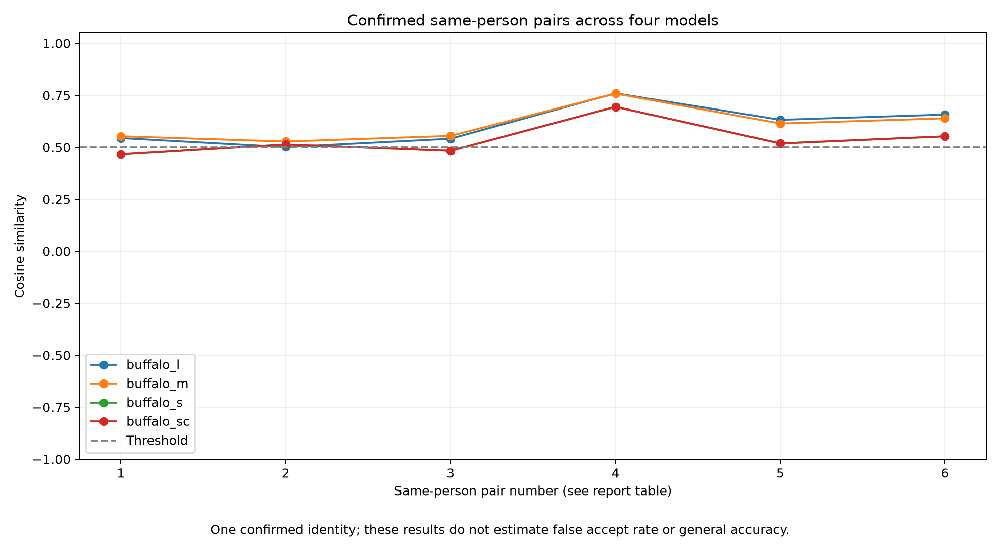

# CDAC m-governance: face verification research

I am comparing four InsightFace Buffalo model packs for an image-based identity verification baseline. I store user embeddings in JSON and evaluate detection, verification scores, storage and processing time.

## Start here for review

**[Open my evaluation report](reports/IMAGE_EVALUATION.md)** ? per-image successes and failures, same-person pair scores and graphs.

| Review material | What it covers |
| --- | --- |
| [All reports](reports/README.md) | Suggested reading order and evidence links |
| [Model limitations](reports/ISSUES.md) | Detection failures, storage requirements and false rejections |
| [Research protocol](reports/RESEARCH_PROTOCOL.md) | My methodology and planned evaluation |
| [Sanity results](reports/SANITY_RESULTS.md) | Identical-image checks and preliminary measurements |
| [Project structure](reports/PROJECT_STRUCTURE.md) | Where code, data and supporting results are stored |

## My current findings

I tested seven images with each of the four models. Every model extracted embeddings from six images and failed to detect a face in one image.

I also tested six distinct pairs from four images I confirmed show the same person, using an experimental similarity threshold of 0.5.

| Model | Images processed successfully | Correct same-person matches | False rejections |
| --- | ---: | ---: | ---: |
| buffalo_l | 6/7 | 6/6 | 0 |
| buffalo_m | 6/7 | 6/6 | 0 |
| buffalo_s | 6/7 | 4/6 | 2 |
| buffalo_sc | 6/7 | 4/6 | 2 |

These findings cover one labelled identity. I have not yet measured false accept rate on confirmed different-person pairs or established a general model ranking.

## Run or extend the project

See **[setup and execution commands](docs/RUNNING.md)** for registration, verification, evaluation and graph generation. I keep active code in `scripts/`, labels in `experiments/`, and local images and embeddings in `data/`.

Supporting measurements are in `results/`. My original implementation is preserved under `baseline/`. Model downloads remain inside `.venv/insightface/`.
