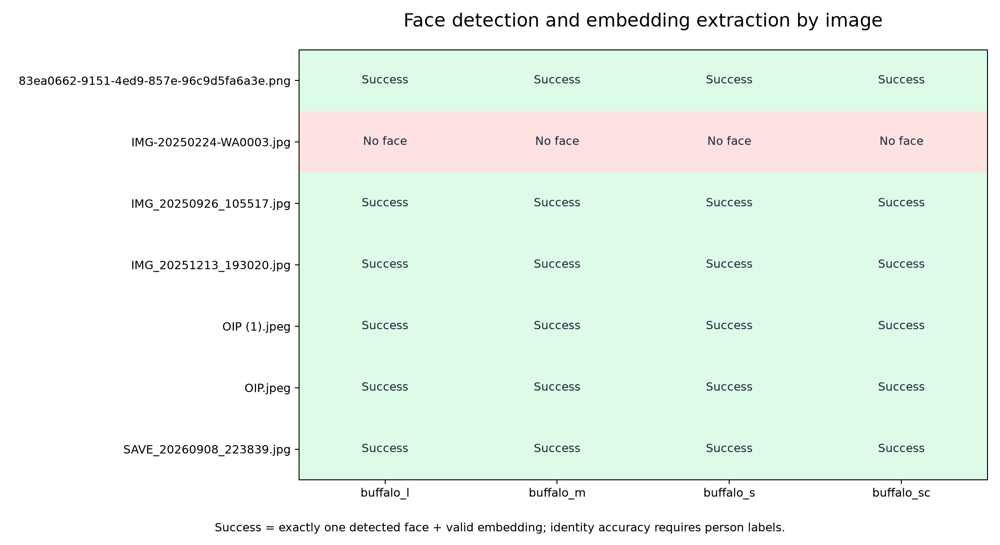

# My evaluation of the available face images

I tested 7 images with all four Buffalo packs using CPU execution, 640 x 640 detection input and detection threshold 0.5.
Success means exactly one face was detected and a valid embedding was extracted. It does not mean the identity was verified correctly.

| Image | buffalo_l | buffalo_m | buffalo_s | buffalo_sc |
| --- | --- | --- | --- | --- |
| 83ea0662-9151-4ed9-857e-96c9d5fa6a3e.png | Success | Success | Success | Success |
| IMG-20250224-WA0003.jpg | no_face_detected | no_face_detected | no_face_detected | no_face_detected |
| IMG_20250926_105517.jpg | Success | Success | Success | Success |
| IMG_20251213_193020.jpg | Success | Success | Success | Success |
| OIP (1).jpeg | Success | Success | Success | Success |
| OIP.jpeg | Success | Success | Success | Success |
| SAVE_20260908_223839.jpg | Success | Success | Success | Success |

## My interpretation

I recorded extraction failures separately from identity decisions. Pairwise scores are saved in the JSON report; pairs involving failed images are marked as not scored.
Accuracy is calculated only for successfully scored pairs with supplied person labels. Without those labels I cannot judge correct matches or false matches.
This small local dataset and single-pass timings do not establish general model accuracy or stable latency.

Detailed evidence: [JSON report](../results/image_evaluation.json) and [CSV outcomes](../results/image_evaluation.csv).

## My confirmed same-person comparison

I labelled the four confirmed images as person_001. I evaluated all six distinct pairs at threshold 0.5. The other images remain unlabelled.

| Model | Correct matches | False rejections | Similarity range |
| --- | ---: | ---: | --- |
| buffalo_l | 6/6 | 0 | 0.501?0.760 |
| buffalo_m | 6/6 | 0 | 0.528?0.759 |
| buffalo_s | 4/6 | 2 | 0.467?0.695 |
| buffalo_sc | 4/6 | 2 | 0.467?0.695 |

### My pair-by-pair outcomes

| Pair | Image A | Image B | buffalo_l | buffalo_m | buffalo_s | buffalo_sc |
| --- | --- | --- | --- | --- | --- | --- |
| 1 | 83ea0662-9151-4ed9-857e-96c9d5fa6a3e.png | IMG_20250926_105517.jpg | 0.545 (Match) | 0.553 (Match) | 0.467 (False rejection) | 0.467 (False rejection) |
| 2 | 83ea0662-9151-4ed9-857e-96c9d5fa6a3e.png | IMG_20251213_193020.jpg | 0.501 (Match) | 0.528 (Match) | 0.514 (Match) | 0.514 (Match) |
| 3 | 83ea0662-9151-4ed9-857e-96c9d5fa6a3e.png | SAVE_20260908_223839.jpg | 0.541 (Match) | 0.555 (Match) | 0.483 (False rejection) | 0.483 (False rejection) |
| 4 | IMG_20250926_105517.jpg | IMG_20251213_193020.jpg | 0.760 (Match) | 0.759 (Match) | 0.695 (Match) | 0.695 (Match) |
| 5 | IMG_20250926_105517.jpg | SAVE_20260908_223839.jpg | 0.632 (Match) | 0.615 (Match) | 0.519 (Match) | 0.519 (Match) |
| 6 | IMG_20251213_193020.jpg | SAVE_20260908_223839.jpg | 0.658 (Match) | 0.640 (Match) | 0.553 (Match) | 0.553 (Match) |

These results cover only one confirmed person. I cannot estimate false accept rate or general recognition accuracy without labelled different-person pairs and more identities.
