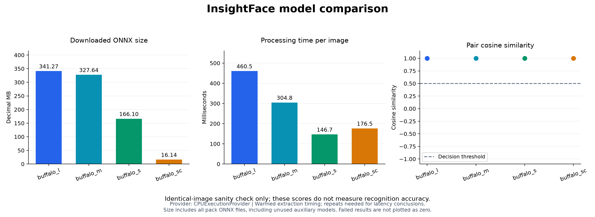

# Local sanity comparison

I compared all four model packs using the same source image on both sides of one genuine pair. I did not include different-person pairs in this check. I use these results to confirm pipeline consistency; they do not establish which model has the best recognition accuracy. My CPU timings come from one warmed run, so I treat them as preliminary measurements.

| Model | ONNX files (MB) | Similarity | Mean seconds/image |
| --- | ---: | ---: | ---: |
| buffalo_l | 341.27 | 1.000000 | 0.461 |
| buffalo_m | 327.64 | 1.000000 | 0.305 |
| buffalo_s | 166.10 | 1.000000 | 0.147 |
| buffalo_sc | 16.14 | 1.000000 | 0.176 |

All four packs passed my identical-image check. This successful run followed the correction for the extra folder in the `buffalo_m` archive. I have saved the environment details and metrics in [sanity_comparison.json](../results/sanity_comparison.json). I still need to evaluate held-out same-person and different-person pairs before selecting the best model for my m-governance project.

## My comparison graph

I use this graph to compare measured storage and preliminary CPU processing time. The identical-image similarity values do not establish recognition accuracy.
